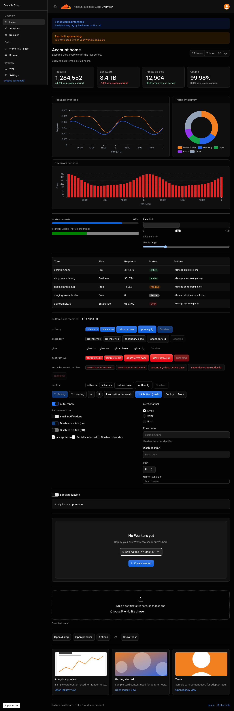
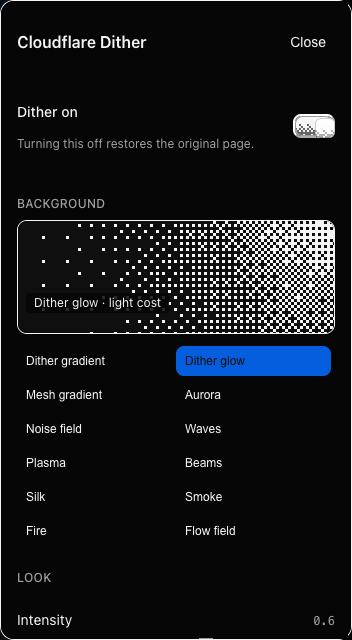
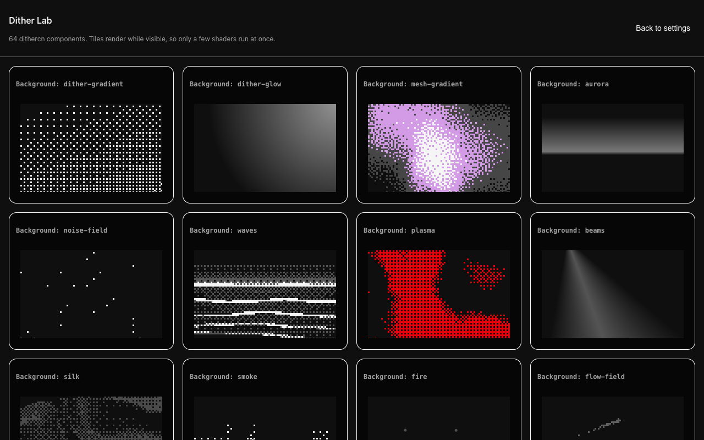

# Cloudflare Dither

A userscript that re-skins the [Cloudflare dashboard](https://dash.cloudflare.com) with
[dithercn](https://dithercn.dev) components: ordered-dither charts, buttons, switches, cards,
tables, sidebar highlights and more.

It is a visual layer only. Every dithered piece is a stand-in drawn under or beside the original
Cloudflare element, which stays in the page, focusable and clickable. Turning a feature (or the
whole script) off restores the page exactly.

| Before | After |
|---|---|
|  |  |

<sub>Screenshots are of the mock dashboard in `fixture/`, built with Cloudflare's open-source
[Kumo](https://github.com/cloudflare/kumo) components. They are not a real account.</sub>

> **Unofficial.** This project is not affiliated with, endorsed by or supported by Cloudflare.
> It changes how the dashboard looks in your own browser and nothing else.

## Status

Early (`0.1.0`). It was developed against a mock dashboard and then tuned on a handful of real
dashboard pages (account home, Workers & Pages, a Worker's overview and settings, DNS records,
zone analytics). Expect rough edges elsewhere; see [Known limitations](#known-limitations).

## Install

1. Install a userscript manager: [Violentmonkey](https://violentmonkey.github.io/) or
   [Tampermonkey](https://www.tampermonkey.net/).
2. Open
   [`dist/cloudflare-dither.user.js`](https://raw.githubusercontent.com/Tresillo2017/cloudflare-dither/main/dist/cloudflare-dither.user.js)
   and confirm the install prompt. (Or build it yourself, below.)
3. Open `https://dash.cloudflare.com/`.

The script makes no network requests and loads nothing remote: React, the dithercn sources and
the styles are all bundled into the one file.

## Using it

Settings live in your userscript manager's menu. Click the manager's toolbar icon while on the
dashboard and pick one of:

| Menu command | What it does |
|---|---|
| **Dither settings** | Opens the settings panel |
| **Dither Lab** | Opens a gallery that renders every dithercn component |
| **Dither: copy selector census** | Copies a structure-only report of the current page (element types and counts, no text) for reporting selector problems |

`Alt+Shift+D` turns the whole re-skin on or off.

If the manager offers no menu (for example the script was pasted with `@grant none`), a small
**Dither** button appears at the bottom right of the page instead.

### Settings panel

- **Master switch.** Off removes every stand-in and leaves the page as Cloudflare drew it.
- **Components.** One switch per adapter, grouped, with a confidence badge and live
  matched/mounted counts.
- **Page background.** Off by default, so the dashboard keeps its own background. Turn on
  "Page background" to pick any of the 31 dithercn backgrounds, with intensity, cell size and
  animation controls.
- **Reset.** Restores every default.

Settings are stored through the manager (`GM_setValue`) when available, otherwise in
`localStorage`.

| Settings panel | Dither Lab |
|---|---|
|  |  |

## What gets dithered

"Default" is whether the adapter is on out of the box. Everything can be toggled in the panel.

| Group | Adapter | Default |
|---|---|---|
| Charts | ECharts charts (area, line, bar, donut, radar, heatmap) | on |
| Charts | KPI tiles, uptime strips, legacy SVG charts | on |
| Charts | Inline sparklines | off |
| Controls | Buttons, switches, checkboxes, sliders, selects and comboboxes, search fields, file drop areas | on |
| Controls | Tabs | off |
| Surfaces | Cards, panels and dialogs, popovers and menus, toolbars | on |
| Surfaces | Sidebar navigation, account switcher, page header band | on |
| Surfaces | List headers and rows, table headers and rows, badges, dividers, link underlines | on |
| Surfaces | Banners and alerts, avatars | off |
| Feedback | Loader, skeleton lines, progress bars, 404 digits | on |
| Feedback | Meters (bar and gauge), empty-state art | off |
| Text | Page title accent (h1) | on |
| Text | Section title accent (h2), breadcrumb scramble | off |
| Images | Cloudflare logo, content images | on |
| Images | Hover-to-compare, scroll reveal, login logo marquee | off |
| Page | Login hero background | on |
| Page | Page background, header fade, map and globe widgets | off |

All 60+ dithercn components are bundled. The ones with no natural home on the dashboard are
still viewable in the Dither Lab. [docs/coverage.md](docs/coverage.md) lists where each one is
used.

## How it works

- **Real dithercn, bundled.** The dithercn engine and component sources are vendored in
  `vendor/dithercn` and bundled with React 19 and compiled Tailwind v4 into a single file by
  esbuild.
- **Adapters.** Each adapter is a selector plus a small React component. One
  `MutationObserver` finds matching Cloudflare elements; each match gets a host element with a
  shadow root, and the stand-in is rendered into it through a React portal. Styles never leak
  into the page, and the page's styles never leak in.
- **Originals stay in charge.** Stand-ins are `inert` and `aria-hidden`. State (checked,
  selected, disabled, hover) is mirrored from the original element, so keyboard, screen readers
  and Cloudflare's own event handlers are untouched.
- **Charts.** The dashboard draws charts with ECharts on a canvas. The chart adapter reads the
  chart's options from the page's React tree and renders the matching dithercn chart in the same
  box. If the data can't be read, the original chart is left alone.
- **Fail closed.** A selector that doesn't match, a render error or an exhausted mount budget
  all end the same way: the original element stays as it was.

More detail: [docs/design.md](docs/design.md), [docs/visual-spec.md](docs/visual-spec.md) and
[docs/adapter-authoring.md](docs/adapter-authoring.md).

## Build

Requires Node 20 or newer.

```sh
npm install
npm run build        # -> dist/cloudflare-dither.user.js
npm run typecheck
```

`node scripts/build.mjs --dev` writes a readable, unminified bundle.

## Testing

```sh
npx playwright install chromium
node fixture/build.mjs   # build the mock dashboard once
npm test                 # full Playwright suite (about 10 minutes)
npm run screenshots      # regenerate docs/screenshots from the mock dashboard
```

The suite runs against `fixture/`, a mock dashboard built with the real `@cloudflare/kumo`
package and served with a Cloudflare-like Content-Security-Policy. It checks, per adapter, that
the stand-in mounts, the original still works, there are no console errors, and disabling the
adapter restores the DOM exactly.

`tests/real/` replays saved copies of real dashboard pages from `real-dom/`. That folder is
git-ignored because the copies contain account data, so those tests skip themselves unless you
capture your own.

## Known limitations

- **Selectors are tied to Cloudflare's current markup.** They rely on Kumo's
  `data-kumo-component` attributes and a few named hooks. A dashboard release can break any
  adapter; the failure mode is that the element simply stays un-dithered.
- **Chart data comes from React internals.** That is not a public API and may stop working.
- **Tabs are off by default.** Kumo draws its own opaque sliding pill, and the dithered
  indicator does not sit under it cleanly yet.
- **Switches and checkboxes need polish** on some real pages.
- **Dark mode has had the most attention** on account home; other pages were mostly checked in
  light mode.
- **Tested in Chromium.** Firefox and real-world use in Violentmonkey and Tampermonkey have had
  little testing so far.
- **At most 8 animated shaders run at once** (a dithercn engine limit), which is why
  high-count elements use CSS and SVG dither fills.

Found a page that looks wrong? Open an issue and paste the output of
**Dither: copy selector census**.

## Credits

- [dithercn](https://github.com/opencoredev/dithercn) by Leo / OpenCore (MIT) provides the
  dither engine and every component. Its licence is in `vendor/dithercn/LICENSE`.
- [Kumo](https://github.com/cloudflare/kumo), Cloudflare's design system, is used to build the
  mock dashboard for tests.

## License

[MIT](LICENSE). Cloudflare and the Cloudflare logo are trademarks of Cloudflare, Inc.
